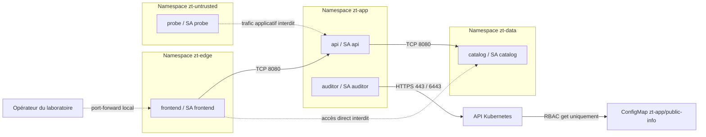

# Kubernetes Zero Trust — Mini-projet DevSecOps

Dépôt GitHub privé : [omar21123/kubernetes-zero-trust](https://github.com/omar21123/kubernetes-zero-trust).

Laboratoire documenté pour contrôler explicitement les **communications**, les **identités** et les **configurations** dans un cluster Kubernetes partagé.

Le projet fournit une application à trois tiers, quatre namespaces, cinq ServiceAccounts, un RBAC minimal, des politiques Default Deny, une politique Kyverno et des démonstrations automatisées. Cilium est le seul CNI ; Hubble observe ses décisions. Le filtrage HTTP L7 est une extension facultative.

Le laboratoire tourne sur **AWS EKS** (Kubernetes managé) : Terraform crée le cluster et ses nœuds, puis un script Python installe les protections et l'application. **Débutants : suivre le [guide pas à pas](docs/guide-aws.md).**

> État de validation : avec la pile actuelle (Kubernetes 1.35, Cilium 1.19.7, Kyverno 1.17.1), les politiques et l'application passent **50/50** contrôles (profil de base) et **51/51** (L7) sur un vrai cluster k3s dans la CI GitHub. Le code Terraform EKS est validé et testé avec un AWS simulé ; le cluster EKS réel reste à constater lors du premier `apply`. Détails : [validation.md](docs/validation.md).

## Architecture



Tous les pods peuvent interroger CoreDNS dans `kube-system` sur UDP/TCP 53. Les autres nouvelles connexions sont refusées. Les flux retour des connexions autorisées sont permis. Le catalogue est un service HTTP avec données fictives en mémoire : il représente le tiers données, sans prétendre être une base de données de production.

## Démarrage rapide

Prérequis sur le PC : Terraform, AWS CLI configurée (`aws configure`), kubectl, Helm et Python 3.11+. Docker n'est pas nécessaire. Détails et commandes Windows : [guide AWS](docs/guide-aws.md).

```console
terraform -chdir=terraform init                  # une seule fois
terraform -chdir=terraform apply                 # crée le cluster EKS + 2 nœuds (~15 min)
python tools/lab.py kubeconfig                   # crée l'accès kubectl
python tools/lab.py up                           # Cilium, Kyverno, puis l'application
python tools/lab.py test                         # démonstrations automatiques
terraform -chdir=terraform destroy               # fin de séance : tout supprimer (~10 min)
```

Pile figée : Kubernetes **1.35** (EKS, support standard jusqu'en mars 2027), Cilium **1.19.7** (chaîné au CNI d'AWS), chart Kyverno **3.7.1** / application **1.17.1**, image `python:3.13.7-slim`. Les versions sont centralisées dans `terraform/variables.tf` et `tools/lab.py`.

**Coût : environ 0,20 $/heure**, soit environ 0,50 $ pour une séance de 2 heures. Lancer `destroy` à la fin de chaque séance.

Afficher l'application dans un autre terminal, après avoir défini `KUBECONFIG` sur `zero-trust.kubeconfig` :

```console
kubectl -n zt-edge port-forward service/frontend 8080:8080
```

Ouvrir [l'application locale](http://localhost:8080). Le port-forward utilise le canal d'administration Kubernetes ; il n'est pas une preuve d'autorisation réseau entre pods, et l'application n'est jamais exposée sur Internet.

## Démonstrations

```console
# Communications autorisées/interdites, DNS, vrais HTTP 403 RBAC, admission
python tools/lab.py test

# Extension HTTP : GET /catalog autorisé ; GET /admin refusé
python tools/lab.py l7-on
python tools/lab.py test --l7
python tools/lab.py l7-off
```

Les résultats réels sont enregistrés dans `artifacts/integration.json` et `artifacts/integration-l7.json`. Une erreur DNS, un HTTP 500 ou une erreur de webhook ne sont pas acceptés comme preuve d'un refus réseau ou d'admission. Un timeout réseau doit être corrélé aux flux Hubble pour attribuer le blocage à la politique.

## Documentation

| Sujet | Document |
|---|---|
| **Pas à pas AWS + Terraform pour débutants** | [Guide AWS](docs/guide-aws.md) |
| Composants, identités, frontières et hypothèses | [Architecture](docs/architecture.md) |
| ServiceAccounts, permissions et droits dangereux | [Accès et RBAC](docs/acces-rbac.md) |
| Matrice de flux, DNS, L7 et observabilité | [Sécurité réseau](docs/reseau.md) |
| Admission, privilèges et hostPath | [Contrôle des configurations](docs/admission.md) |
| Scénario de soutenance et résultats attendus | [Démonstrations](docs/demonstrations.md) |
| Compromission, propagation et réponse | [Analyse du blast radius](docs/blast-radius.md) |
| Installation, diagnostic, entretien et publication | [Exploitation](docs/exploitation.md) |
| Synthèse et réponse à la question du sujet | [Rapport](docs/rapport.md) |
| Vérifications effectivement exécutées | [Validation](docs/validation.md) |
| Références officielles | [Sources](docs/sources.md) |

## Organisation du dépôt

```text
terraform/              Cluster AWS EKS : rôles IAM, cluster, nœuds (+ test simulé)
app/                    Application Python, sans dépendance tierce (montée par ConfigMap)
cluster/                Valeurs Helm de Cilium (EKS) et de Kyverno
manifests/              Namespaces, identités, RBAC, quotas et workloads
policies/admission/     Baseline Kyverno Restricted + identité + filesystem
policies/network/       Default Deny et autorisations Kubernetes L3/L4
policies/cilium/        Accès du seul auditor à l'API Kubernetes
policies/optional/      Filtrage HTTP L7 activable
tools/                  Cycle de vie et vérification structurelle
tests/                  Tests Python, manifests dangereux et k3s de la CI
docs/                   Dossier technique et support de soutenance
artifacts/              Rapports produits à l'exécution, ignorés par Git
.github/workflows/      Contrôles hors cluster, Terraform et démonstrations sur un k3s gratuit
```

## Contrôles hors cluster

```console
python -m pip install -r requirements-dev.txt
python tools/validate.py
python -m unittest discover -s tests -v
# Si Kyverno CLI 1.17.1 est installe :
kyverno test tests/kyverno --remove-color
```

Le contrôle structurel ne remplace pas l'évaluation des règles. Kyverno CLI vérifie les cas conformes, les violations et les règles générées pour les Deployments ; les tests sur cluster vérifient ensuite les webhooks, RBAC et l'application réseau par Cilium. La CI GitHub Actions exécute ces niveaux, vérifie le code Terraform (`fmt`, `validate`, `test`), rejoue toutes les démonstrations sur un petit cluster k3s gratuit, puis conserve les rapports d'intégration comme artifacts.

## Réponse à la question du projet

Appliquer Zero Trust consiste à **décrire quelques droits et flux nécessaires puis à refuser le reste** : une identité par workload, aucun jeton sans besoin, des permissions sur une ressource nommée, Default Deny et un contrat d'admission unique. RBAC contrôle l'API ; Cilium contrôle le réseau ; Kyverno contrôle les configurations ; Hubble fournit les preuves. Chaque mécanisme répond à une question différente. Ajouter mTLS, un service mesh ou un second moteur d'admission uniquement si le modèle de menace le justifie.

Ce laboratoire limite la propagation ; il n'apporte ni authentification métier entre services, ni chiffrement des flux HTTP, ni isolation forte contre un administrateur ou un nœud compromis. Les [limites](docs/blast-radius.md) font partie de l'analyse attendue.

Pour tout supprimer dans AWS (cluster, nœuds, disques, rôles IAM) :

```console
terraform -chdir=terraform destroy
```
