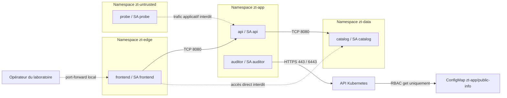

# Kubernetes Zero Trust — Mini-projet DevSecOps

Dépôt GitHub privé : [omar21123/kubernetes-zero-trust](https://github.com/omar21123/kubernetes-zero-trust).

Laboratoire documenté pour contrôler explicitement les **communications**, les **identités** et les **configurations** dans un cluster Kubernetes partagé.

Le projet fournit une application à trois tiers, quatre namespaces, cinq ServiceAccounts, un RBAC minimal, des politiques Default Deny, une politique Kyverno et des démonstrations automatisées. Cilium est le seul CNI ; Hubble observe ses décisions. Le filtrage HTTP L7 est une extension facultative.

> État de validation : les tests Python, les contrôles structurels et les tests des politiques avec Kyverno CLI 1.15.2 ont été exécutés localement. Les démonstrations Kubernetes nécessitent Docker, kind, kubectl et Helm, absents de l'environnement de création. La CI est fournie mais son exécution distante n'est pas attestée. Voir [les résultats et leurs limites](docs/validation.md).

## Architecture



Tous les pods peuvent interroger CoreDNS dans `kube-system` sur UDP/TCP 53. Les autres nouvelles connexions sont refusées. Les flux retour des connexions autorisées sont permis. Le catalogue est un service HTTP avec données fictives en mémoire : il représente le tiers données, sans prétendre être une base de données de production.

## Démarrage

Prérequis : Docker avec conteneurs Linux, Python 3.11+, kind **v0.29.0**, kubectl **v1.33.x** et Helm **v3.18.x** dans le PATH. Prévoir environ 4 CPU, 8 Go de RAM disponibles et 10 Go de disque. Sous Windows, utiliser Docker Desktop avec son moteur Linux ; WSL2 est une alternative si les contraintes eBPF du moteur local empêchent Cilium de démarrer.

La pile pédagogique est figée : Kubernetes **1.33.1**, Cilium **1.18.3**, chart Kyverno **3.5.2** / application **1.15.2**. Ces versions servent à reproduire le laboratoire ; elles ne constituent pas une recommandation de versions maintenues pour novembre 2026. Les versions et l'image kind par digest sont centralisées dans `tools/lab.py`. Actualiser ensemble les composants avant toute utilisation réelle.

Depuis la racine du dépôt, dans PowerShell ou un shell Linux :

```console
python tools/lab.py doctor
python tools/lab.py up
python tools/lab.py test
```

`up` crée exclusivement le cluster `zero-trust`, installe les contrôles avant les workloads, construit l'image et la charge dans les nœuds kind. Les commandes kubectl et Helm du script ciblent explicitement `kind-zero-trust`. `up` refuse de réutiliser silencieusement un cluster existant ; `deploy` réapplique le projet et restaure le profil réseau de base.

Afficher l'application dans un autre terminal :

```console
kubectl --context kind-zero-trust -n zt-edge port-forward service/frontend 8080:8080
```

Ouvrir [l'application locale](http://localhost:8080). Le port-forward utilise le canal d'administration Kubernetes ; il n'est pas une preuve d'autorisation réseau entre pods.

## Démonstrations

```console
# Communications autorisées/interdites, DNS, vrais HTTP 403 RBAC, admission
python tools/lab.py test

# Extension HTTP : GET /catalog autorisé ; GET /admin refusé
python tools/lab.py l7-on
python tools/lab.py test --l7
python tools/lab.py l7-off
```

Les résultats réels sont enregistrés dans `artifacts/integration.json` et `artifacts/integration-l7.json`. Une erreur DNS, un HTTP 500 ou une erreur de webhook ne sont pas acceptés comme preuve d'un refus réseau ou d'admission. Un timeout réseau doit être corrélé aux flux Hubble pour attribuer le blocage à la politique.

## Documentation

| Sujet | Document |
|---|---|
| Composants, identités, frontières et hypothèses | [Architecture](docs/architecture.md) |
| ServiceAccounts, permissions et droits dangereux | [Accès et RBAC](docs/acces-rbac.md) |
| Matrice de flux, DNS, L7 et observabilité | [Sécurité réseau](docs/reseau.md) |
| Admission, privilèges et hostPath | [Contrôle des configurations](docs/admission.md) |
| Scénario de soutenance et résultats attendus | [Démonstrations](docs/demonstrations.md) |
| Compromission, propagation et réponse | [Analyse du blast radius](docs/blast-radius.md) |
| Installation, diagnostic, entretien et publication | [Exploitation](docs/exploitation.md) |
| Synthèse et réponse à la question du sujet | [Rapport](docs/rapport.md) |
| Vérifications effectivement exécutées | [Validation](docs/validation.md) |
| Références officielles | [Sources](docs/sources.md) |

## Organisation du dépôt

```text
app/                    Application Python et Dockerfile, sans dépendance tierce
cluster/                Cluster kind et valeurs Helm
manifests/              Namespaces, identités, RBAC, quotas et workloads
policies/admission/     Baseline Kyverno Restricted + identité + filesystem
policies/network/       Default Deny et autorisations Kubernetes L3/L4
policies/cilium/        Accès du seul auditor à l'API Kubernetes
policies/optional/      Filtrage HTTP L7 activable
tools/                  Cycle de vie et vérification structurelle
tests/                  Tests Python et manifests dangereux pour dry-run serveur
docs/                   Dossier technique et support de soutenance
artifacts/              Rapports produits à l'exécution, ignorés par Git
.github/workflows/      Contrôles hors cluster et démonstrations sur kind
```

## Contrôles hors cluster

```console
python -m pip install -r requirements-dev.txt
python tools/validate.py
python -m unittest discover -s tests -v
# Si Kyverno CLI 1.15.2 est installe :
kyverno test tests/kyverno --remove-color
```

Le contrôle structurel ne remplace pas l'évaluation des règles. Kyverno CLI vérifie les cas conformes, les violations et les règles générées pour les Deployments ; les tests sur cluster vérifient ensuite les webhooks, RBAC et l'application réseau par Cilium. La CI GitHub Actions exécute ces niveaux, puis conserve les rapports d'intégration comme artifacts.

## Réponse à la question du projet

Appliquer Zero Trust consiste à **décrire quelques droits et flux nécessaires puis à refuser le reste** : une identité par workload, aucun jeton sans besoin, des permissions sur une ressource nommée, Default Deny et un contrat d'admission unique. RBAC contrôle l'API ; Cilium contrôle le réseau ; Kyverno contrôle les configurations ; Hubble fournit les preuves. Chaque mécanisme répond à une question différente. Ajouter mTLS, un service mesh ou un second moteur d'admission uniquement si le modèle de menace le justifie.

Ce laboratoire limite la propagation ; il n'apporte ni authentification métier entre services, ni chiffrement des flux HTTP, ni isolation forte contre un administrateur ou un nœud compromis. Les [limites](docs/blast-radius.md) font partie de l'analyse attendue.

Pour supprimer explicitement le cluster du laboratoire :

```console
python tools/lab.py down --confirm-delete
```
