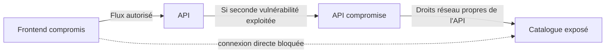

# Analyse du blast radius

Le blast radius est l'ensemble des ressources et opérations qu'un attaquant peut atteindre après une compromission. Il dépend des droits de l'identité, des communications permises et des vulnérabilités encore exploitables dans les destinations autorisées.

## Hypothèse : exécution de code dans un conteneur

| Workload compromis | Accès direct restant | Ce qui limite l'extension | Risque résiduel |
|---|---|---|---|
| frontend | API TCP 8080, CoreDNS, mémoire et fichiers lisibles locaux | Pas de jeton ; pas de droit RBAC ; accès direct catalog et API server bloqués | Abus des fonctions API autorisées ; exploitation d'une vulnérabilité de l'API |
| api | Catalog TCP 8080, CoreDNS, état local | Aucun jeton ; pas d'accès API server ni de sortie arbitraire | Lecture de toutes les données que catalog expose au rôle applicatif ; attaque du tiers données |
| catalog | CoreDNS et état local | Aucune nouvelle connexion applicative sortante ; pas de jeton | Fuite du jeu de données, falsification des réponses ; exfiltration possible par DNS ou via un appelant autorisé |
| auditor | API server ; GET d'un ConfigMap nommé et découverte par défaut | RBAC interdit secrets, autres ConfigMaps, création de pods et modification des droits | Vol du ConfigMap public et du jeton temporaire ; exposition de métadonnées de découverte |
| probe | CoreDNS et état local | Aucun flux applicatif autorisé ni jeton | DNS, consommation de son budget et recherche de vulnérabilités locales |

## Chemin de propagation transitive

Le blocage direct frontend → catalog ne garantit pas que les données restent inaccessibles au frontend : l'application est conçue pour les lui transmettre via l'API. Les politiques réduisent les chemins de propagation, elles ne remplacent pas l'autorisation métier ni la correction des failles.

Avec l'option L7, un frontend compromis ne peut appeler que GET `/health` et GET `/catalog` vers l'API. Il peut encore abuser de ces routes, de leurs paramètres s'ils étaient ajoutés et de leurs vulnérabilités. Les quotas réduisent le déni de service par consommation locale mais ne constituent pas une limitation de débit HTTP.

## Hypothèse : jeton auditor volé hors du pod

La règle réseau Cilium protège la sortie des pods ; elle ne borne pas l'origine d'utilisation d'un jeton volé. Depuis un poste qui atteint l'API server, ce jeton conserve les mêmes droits RBAC jusqu'à expiration ou invalidation. Il ne donne pas accès aux secrets. Supprimer le pod concerné invalide le jeton lié au pod une fois la suppression prise en compte par l'API ; une révocation opérationnelle doit être vérifiée. Réduire les droits de la Role ou retirer son RoleBinding coupe l'autorisation indépendamment de la durée de vie du jeton.

## Ce qui dépasse le périmètre

Une compromission de nœud, du CNI, de l'API server ou d'un administrateur dépasse ce modèle. Un même noyau reste partagé entre les pods d'un nœud. `readOnlyRootFilesystem`, seccomp et l'UID non root réduisent l'exposition mais ne corrigent pas une faille noyau.

Les communications HTTP du laboratoire sont en clair et ne fournissent pas d'identité cryptographique de l'appelant. Le chiffrement réseau ou mTLS peut être ajouté si le modèle de menace inclut l'interception et l'usurpation hors du plan de contrôle Kubernetes. Les images sont versionnées pour le laboratoire mais ne sont ni signées ni vérifiées à l'admission.

## Réponse à incident proposée

1. Identifier le pod, son ServiceAccount et les destinations contactées grâce à Hubble, aux journaux applicatifs et, si disponible, aux journaux d'audit Kubernetes.
2. Isoler les flux en retirant les autorisations applicables ou en appliquant une politique de refus explicite compatible Cilium. Ajouter seulement une nouvelle NetworkPolicy vide ne retire pas les permissions additives existantes.
3. Pour auditor, retirer le RoleBinding et remplacer le pod ; vérifier l'échec d'utilisation de l'ancien jeton sans l'afficher dans les journaux.
4. Conserver les éléments d'enquête puis redéployer une image corrigée. Refaire les contrôles réseau, RBAC et admission.
5. Examiner les destinations autorisées pour rechercher une seconde compromission et revoir les besoins de chaque flux.
