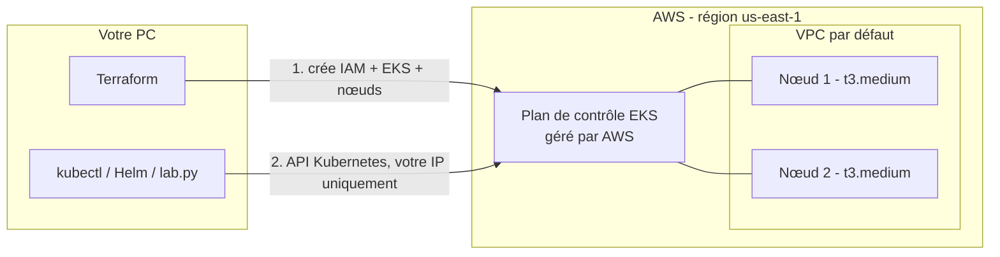

# Guide pas à pas : le laboratoire sur AWS EKS avec Terraform

Ce guide part de zéro. Suivez les étapes dans l'ordre : chaque commande est expliquée. Durée : environ 45 minutes la première fois (dont 15 minutes d'attente pendant la création du cluster).

> **Coût** : environ **0,20 $/heure** tant que le cluster existe, soit **environ 0,50 $ pour une séance de 2 heures**. Toujours finir par `terraform -chdir=terraform destroy` (étape 9) : un cluster oublié coûte environ 5 $ par jour.

## 1. Ce que l'on construit



1. **Terraform** crée dans AWS un cluster **EKS** : AWS gère le plan de contrôle (API server, etcd) et Terraform ajoute 2 machines « workers » qui exécutent les pods.
2. Depuis votre PC, **`lab.py`** installe les protections du projet (Cilium, Kyverno, RBAC, NetworkPolicy), puis l'application.

| Outil | À quoi il sert | En une phrase |
|---|---|---|
| **AWS EKS** | Kubernetes managé | AWS fait tourner et met à jour le plan de contrôle ; on ne gère que les nœuds |
| **Terraform** | Créer l'infrastructure à partir de fichiers texte | On décrit ce qu'on veut (`terraform/*.tf`), Terraform le crée, et le supprime avec `destroy` |
| **AWS CLI** (`aws`) | Ligne de commande AWS | Sert à s'identifier auprès d'AWS et à créer l'accès `kubectl` |
| **kubectl** | Télécommande de Kubernetes | `kubectl get pods` interroge l'API du cluster |
| **Helm** | Installateur de logiciels pour Kubernetes | Installe Cilium et Kyverno en une commande |
| **Cilium** | Application des NetworkPolicy + Hubble | Applique le « tout est interdit sauf… » réseau ; Hubble montre les flux |
| **Kyverno** | Contrôle d'admission | Refuse les pods dangereux (privilégiés, root, hostPath…) |
| **tools/lab.py** | Automatisation du projet | Enchaîne les commandes kubectl/Helm et les démonstrations |

**Réseau sur EKS.** EKS installe son propre plugin réseau, **AWS VPC CNI** : chaque pod reçoit une vraie adresse IP du VPC. Ce plugin n'applique pas nos NetworkPolicy par défaut. On ajoute donc **Cilium en mode chaînage** (*chaining*) : AWS fournit les IP, Cilium filtre les flux et alimente Hubble.

## 2. Installer les outils (une seule fois)

**Windows** : ouvrir PowerShell et lancer ces lignes une par une :

```powershell
winget install --id Hashicorp.Terraform
winget install --id Amazon.AWSCLI
winget install --id Kubernetes.kubectl
winget install --id Helm.Helm
winget install --id Python.Python.3.13
winget install --id Git.Git
```

Fermer puis rouvrir PowerShell, et vérifier :

```powershell
terraform version
aws --version
kubectl version --client
helm version
python --version
```

Si `python` ouvre le Microsoft Store, utiliser `py` à la place de `python` dans tout le guide.

**macOS** : `brew install terraform awscli kubectl helm python`. **Linux** : suivre les liens de [exploitation.md](exploitation.md#installation-des-outils).

Récupérer ensuite le projet, une seule fois, et travailler depuis ce dossier pour toutes les commandes suivantes :

```powershell
git clone https://github.com/omar21123/kubernetes-zero-trust.git
cd kubernetes-zero-trust
```

## 3. Préparer le compte AWS (une seule fois)

1. **Ne pas utiliser le compte racine** (l'adresse e-mail du compte) pour le travail. Dans la console AWS → **IAM** → **Users** → **Create user**, créer un utilisateur (par exemple `terraform-lab`) et lui attacher la politique `AdministratorAccess`. C'est large, mais Terraform doit créer des rôles IAM et un cluster EKS. Ce compte ne sert qu'au laboratoire.
2. Ouvrir cet utilisateur → **Security credentials** → **Create access key** → usage **CLI**. Noter la clé et le secret : le secret ne s'affiche qu'une fois.
3. Sur le PC :

   ```powershell
   aws configure
   ```

   Coller la clé, puis le secret, choisir la région `us-east-1` et le format `json`.
4. Vérifier (doit afficher votre numéro de compte et `user/terraform-lab`) :

   ```powershell
   aws sts get-caller-identity
   ```

5. **Créer une alerte de budget** : console AWS → **Billing** → **Budgets** → **Create budget** → modèle *Zero spend budget* ou *Monthly cost budget* à 5 $. Vous recevrez un e-mail si quelque chose reste allumé par erreur.

**Pour un groupe** : une seule personne lance `terraform apply` et `destroy` (l'état Terraform est stocké sur son PC). Chaque coéquipier peut avoir son propre utilisateur IAM dans le même compte ; ajoutez leurs ARN dans `extra_admin_arns` (étape 5) pour qu'ils puissent utiliser `kubectl`.

## 4. Comprendre les fichiers Terraform

| Fichier | Ce qu'il crée ou décrit |
|---|---|
| `versions.tf` | Versions de Terraform et des plugins (AWS, HTTP) |
| `variables.tf` | Paramètres : région, version Kubernetes (1.35), type et nombre de nœuds, IP autorisées, coéquipiers |
| `network.tf` | **Rien n'est créé** : lecture du VPC par défaut, des sous-réseaux et de votre IP publique |
| `iam.tf` | 2 rôles IAM : un pour EKS, un pour les nœuds, avec les seules politiques AWS nécessaires |
| `eks.tf` | Le cluster EKS, le modèle des VM (disque chiffré, métadonnées protégées) et le groupe de 2 nœuds |
| `outputs.tf` | Valeurs affichées à la fin : nom du cluster, région |
| `terraform.tfvars.example` | Modèle pour changer un paramètre (copier en `terraform.tfvars`) |
| `tests/plan.tftest.hcl` | Test automatique avec un AWS simulé (`terraform -chdir=terraform test`) |
| `terraform.tfstate` (créé) | **Mémoire** de Terraform : ce qu'il a créé. Ne pas supprimer ni publier |

## 5. Créer le cluster avec Terraform

```powershell
terraform -chdir=terraform init
```

`init` télécharge les plugins AWS et HTTP dans `terraform/.terraform/`. À faire une seule fois.

*(Optionnel, groupe)* Pour ajouter des coéquipiers ou plusieurs IP, copier `terraform/terraform.tfvars.example` en `terraform/terraform.tfvars` et compléter `extra_admin_arns` / `allowed_cidrs`.

```powershell
terraform -chdir=terraform plan
```

`plan` montre ce qui **va** être créé, sans rien créer. Lisez la fin : `Plan: 9 to add, 0 to change, 0 to destroy.`

| Ressource | Rôle |
|---|---|
| `aws_iam_role.cluster` + 1 `aws_iam_role_policy_attachment` | Identité d'EKS |
| `aws_iam_role.nodes` + 3 `aws_iam_role_policy_attachment` | Identité des nœuds |
| `aws_eks_cluster.lab` | Le cluster Kubernetes 1.35 |
| `aws_launch_template.nodes` | Modèle des VM workers |
| `aws_eks_node_group.nodes` | Les 2 VM workers |

```powershell
terraform -chdir=terraform apply
```

Taper `yes`. **Patience : 12 à 18 minutes** (environ 10 minutes pour le cluster, puis 3 à 5 pour les nœuds). Ne fermez pas le terminal.

## 6. Récupérer l'accès au cluster

```powershell
python tools/lab.py kubeconfig
```

La commande lance `aws eks update-kubeconfig` et crée `zero-trust.kubeconfig` à la racine du projet. Ce fichier ne contient pas de mot de passe : à chaque commande, `kubectl` demande un jeton temporaire à AWS avec **votre** identité IAM. Ne le publiez pas pour autant (il est ignoré par Git).

Pour que `kubectl` l'utilise dans ce terminal :

```powershell
$env:KUBECONFIG = "$PWD\zero-trust.kubeconfig"   # PowerShell
```

```bash
export KUBECONFIG=$PWD/zero-trust.kubeconfig     # macOS / Linux
```

```powershell
kubectl get nodes
```

Deux nœuds `Ready` doivent apparaître.

## 7. Installer la sécurité et l'application

```powershell
python tools/lab.py up
```

Environ 5 minutes. Le script installe, dans cet ordre :

1. **Cilium** (Helm, valeurs `cluster/cilium-eks.yaml`), puis redémarre CoreDNS pour qu'il soit protégé par Cilium.
2. **Kyverno** (Helm) → le contrôle d'admission est actif.
3. Les **namespaces**, les **ServiceAccounts** et le **RBAC** (`manifests/00` à `20`).
4. La politique d'admission Kyverno (`policies/admission/`).
5. Les **NetworkPolicy** : Default Deny, DNS, flux autorisés (`policies/network/`), puis la règle Cilium de l'auditor (`policies/cilium/`).
6. Le **code Python** dans un ConfigMap `app-code` (pas d'image Docker à construire : l'image officielle `python:3.13.7-slim` monte ce code en lecture seule).
7. Les 5 **workloads** (`manifests/30-workloads.yaml`).

Les protections sont posées **avant** les applications : aucun pod ne démarre sans elles.

```powershell
kubectl get pods -A
```

## 8. Lancer les démonstrations

```powershell
python tools/lab.py test
```

Chaque ligne affiche `PASS` ou `FAIL`. Le rapport complet est écrit dans `artifacts/integration.json`. Les tests couvrent les démonstrations demandées par le sujet :

| Démonstration du sujet | Tests correspondants |
|---|---|
| Une communication non autorisée est bloquée | `frontend -> catalog refuse`, `probe -> api refuse`… (par Service **et** par IP de pod) |
| Un workload ne peut pas accéder à une ressource non autorisée | `auditor: … trois acces HTTP 403`, `RBAC auditor … : no`, `sans jeton monte` |
| Une configuration dangereuse est rejetée | `admission refuse: privileged`, `hostpath`, `root`… |
| Le blast radius après compromission | Expliqué dans [blast-radius.md](blast-radius.md), appuyé par les refus ci-dessus |

La démonstration manuelle, commande par commande, est dans [demonstrations.md](demonstrations.md).

**Voir l'application** (dans un second terminal, avec le même `KUBECONFIG`) :

```powershell
kubectl -n zt-edge port-forward service/frontend 8080:8080
```

Ouvrir <http://localhost:8080>. Le trafic passe par l'API Kubernetes chiffrée : l'application n'est **jamais** exposée sur Internet (aucun Load Balancer, donc aucun coût supplémentaire).

**Voir les flux réseau dans Hubble** :

```powershell
kubectl -n kube-system port-forward service/hubble-ui 12000:80
```

Ouvrir <http://localhost:12000>, choisir le namespace `zt-edge`, relancer `python tools/lab.py test` : les flux refusés apparaissent en rouge (`DROPPED`).

**Extension L7 (facultative).** `python tools/lab.py l7-on` puis `python tools/lab.py test --l7` vérifient que `GET /admin` est refusé en HTTP 403. En chaînage avec le CNI d'AWS, le filtrage HTTP de Cilium n'est pas garanti : si ce test échoue sur EKS, présentez-le comme une limite du mode chaînage (il passe dans la CI, où Cilium est le seul CNI). Revenir ensuite au profil de base avec `python tools/lab.py l7-off`.

## 9. Tout supprimer (à chaque fin de séance)

```powershell
terraform -chdir=terraform destroy
```

Taper `yes`. Environ 10 minutes. Tout ce que Terraform a créé disparaît : cluster, nœuds, disques, rôles IAM. Cilium, Kyverno et l'application disparaissent avec le cluster. Supprimer ensuite `zero-trust.kubeconfig`, qui ne sert plus à rien.

Vérifier dans la console AWS → **EKS** qu'aucun cluster ne reste, et → **EC2** → *Instances* qu'aucune instance `zero-trust-node` ne tourne.

| Élément | Prix (us-east-1) | Séance de 2 h (+ ~30 min de création/suppression) |
|---|---|---|
| Plan de contrôle EKS, version 1.35 en support standard | 0,10 $/h | ≈ 0,25 $ |
| 2 nœuds t3.medium | 2 × 0,0416 $/h | ≈ 0,21 $ |
| IP publiques des nœuds et disques 2 × 20 Go | ≈ 0,01 $/h | ≈ 0,03 $ |
| **Total** | **≈ 0,20 $/h** | **≈ 0,50 $** |

Ce qui pourrait faire grimper la facture, et pourquoi ce projet l'évite :

- **Version Kubernetes en support étendu** : 0,60 $/h au lieu de 0,10 $/h. Le projet utilise la 1.35 (support standard jusqu'en mars 2027) et `upgrade_policy = STANDARD`.
- **NAT Gateway** : environ 0,045 $/h. Non utilisée : les nœuds sont dans les sous-réseaux publics du VPC par défaut.
- **Load Balancer** : environ 0,02 $/h. Non utilisé : on passe par `kubectl port-forward`.
- **Oubli du `destroy`** : environ 5 $/jour. D'où l'alerte de budget de l'étape 3.

## 10. Problèmes fréquents

| Message ou symptôme | Cause | Solution |
|---|---|---|
| `No valid credential sources found` | AWS CLI non configurée | Refaire l'étape 3 |
| `no matching EC2 VPC found` | Le compte n'a pas de VPC par défaut | `aws ec2 create-default-vpc`, puis relancer `apply` |
| `EntityAlreadyExists: Role with name zero-trust-eks-…` ou `ResourceInUseException` (cluster) | Une ancienne installation existe encore | Relancer `destroy` depuis le dossier qui contient l'ancien `terraform.tfstate`, ou supprimer le cluster `zero-trust` et les rôles `zero-trust-eks-*` dans la console |
| `UnsupportedAvailabilityZoneException` | Zone non prise en charge par EKS | Relancer `apply` ; si besoin changer de région (`aws_region`) |
| `apply` dure plus de 20 minutes sur le node group | Les nœuds n'arrivent pas à rejoindre le cluster | Console EKS → Compute → node group → *Health issues* |
| `kubectl` : `You must be logged in to the server` | Vous n'utilisez pas l'identité AWS qui a créé le cluster | `aws sts get-caller-identity` ; coéquipier : ajouter son ARN dans `extra_admin_arns` puis `apply` |
| `kubectl` : *timeout* | Votre IP publique a changé (autre Wi-Fi, partage de connexion) | Relancer `terraform -chdir=terraform apply` : l'IP autorisée est mise à jour (quelques minutes) |
| `python` ouvre le Microsoft Store | Alias Windows | Utiliser `py tools/lab.py …` |

Autres symptômes Kubernetes : voir [exploitation.md](exploitation.md#diagnostic).

## 11. Sécurité de l'infrastructure AWS (à présenter en soutenance)

Le principe Zero Trust s'applique aussi **autour** du cluster :

| Mesure | Où | Ce qu'elle empêche |
|---|---|---|
| API Kubernetes publique **limitée à votre IP** | `public_access_cidrs` (`eks.tf`) | Attaque de l'API depuis Internet |
| Nœuds → API par le **réseau privé** du VPC | `endpoint_private_access` | Exposer le trafic des nœuds à Internet |
| Accès au cluster par **identité IAM**, sans mot de passe | `access_config` (mode `API`) | Partage de mots de passe ; chaque accès est nominatif et révocable |
| Rôles IAM séparés avec des **politiques minimales** | `iam.tf` | Un composant qui obtient plus de droits AWS qu'il n'en a besoin |
| **IMDSv2 limité à 1 saut** sur les nœuds | `aws_launch_template.nodes` | Un pod compromis ne peut pas voler les identifiants AWS du nœud |
| **Disques des nœuds chiffrés** | `block_device_mappings` | Lecture des données si un disque était copié |
| Aucun accès SSH aux nœuds, aucune application exposée | `eks.tf`, Services `ClusterIP` | Surface d'attaque réseau inutile |
| **Pas de support étendu** automatique | `upgrade_policy` | Surcoût, et rappel de tenir le cluster à jour |

EKS chiffre également par défaut les données de l'API Kubernetes (dont les Secrets) avec une clé gérée par AWS.

**Limites assumées** : AWS gère le plan de contrôle (on lui fait confiance) ; les nœuds sont dans des sous-réseaux publics pour éviter le coût d'une NAT Gateway (protégés par le groupe de sécurité d'EKS, mais une architecture de production les placerait en sous-réseaux privés) ; un administrateur du cluster ou un nœud compromis dépasse le modèle (voir [blast-radius.md](blast-radius.md)) ; l'état Terraform est local, donc une seule personne lance `apply` et `destroy`.

## 12. Ce qui a changé par rapport à la version locale (kind)

| Avant (kind sur le PC) | Maintenant (AWS EKS) |
|---|---|
| Docker Desktop + kind, 8 Go de RAM sur le PC | Rien de lourd sur le PC : AWS fait tourner le cluster |
| 3 nœuds dans des conteneurs Docker | Plan de contrôle managé + 2 nœuds EC2 |
| Kubernetes 1.33, Cilium 1.18.3, Kyverno 1.15.2 | Kubernetes 1.35, Cilium 1.19.7, Kyverno 1.17.1 |
| Cilium seul CNI | Cilium chaîné derrière le CNI d'AWS |
| Image Docker construite puis chargée dans kind | Image officielle `python:3.13.7-slim` + code dans un ConfigMap |
| `python tools/lab.py up` crée le cluster | `terraform apply` crée le cluster, `lab.py up` installe le reste |
| `python tools/lab.py down` | `terraform -chdir=terraform destroy` |

Les politiques (RBAC, NetworkPolicy, Kyverno, Cilium) et les tests sont **inchangés**.
