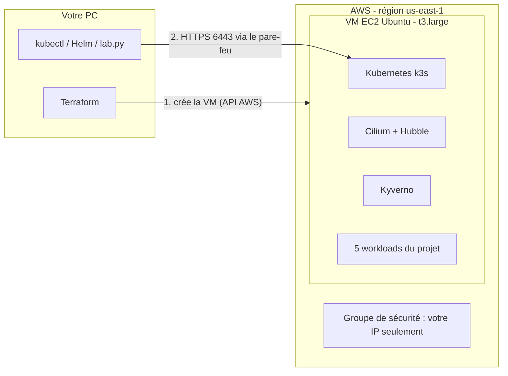

# Guide pas à pas : le laboratoire sur AWS avec Terraform

Ce guide part de zéro. Suivez les étapes dans l'ordre : chaque commande est expliquée. Durée totale : environ 30 minutes la première fois, 10 minutes ensuite.

## 1. Ce que l'on construit



1. **Terraform** crée dans AWS une machine virtuelle (VM). Au premier démarrage, elle installe Kubernetes tout seule.
2. Depuis votre PC, **`lab.py`** se connecte à ce Kubernetes et installe les protections du projet (Cilium, Kyverno, RBAC, NetworkPolicy), puis l'application.

| Outil | À quoi il sert | En une phrase |
|---|---|---|
| **AWS EC2** | Louer une VM dans le cloud | Un ordinateur Linux chez Amazon, payé à l'heure |
| **Terraform** | Créer l'infrastructure à partir de fichiers texte | On décrit ce qu'on veut (`terraform/*.tf`), Terraform le crée, et le supprime avec `destroy` |
| **k3s** | Kubernetes complet en un seul programme | Le même Kubernetes que d'habitude, mais léger : un seul nœud suffit |
| **kubectl** | Télécommande de Kubernetes | `kubectl get pods` interroge l'API du cluster |
| **Helm** | Installateur de logiciels pour Kubernetes | Installe Cilium et Kyverno en une commande |
| **Cilium** | Réseau des pods + NetworkPolicy | Applique le « tout est interdit sauf… » réseau ; Hubble montre les flux |
| **Kyverno** | Contrôle d'admission | Refuse les pods dangereux (privilégiés, root, hostPath…) |
| **tools/lab.py** | Automatisation du projet | Enchaîne les commandes kubectl/Helm et les démonstrations |

**Pourquoi une seule VM et pas EKS (le Kubernetes géré d'AWS) ?** C'est plus simple (4 ressources AWS au lieu d'une vingtaine), plus rapide (5 minutes au lieu de 20), moins cher (environ 2 $/jour au lieu de 6 $), compatible avec AWS Academy, et cela garde Cilium et toutes les démonstrations du projet. Les mécanismes Kubernetes étudiés (RBAC, NetworkPolicy, admission) sont exactement les mêmes.

## 2. Installer les outils (une seule fois)

**Windows** : ouvrir PowerShell et lancer ces lignes une par une :

```powershell
winget install --id Hashicorp.Terraform
winget install --id Kubernetes.kubectl
winget install --id Helm.Helm
winget install --id Python.Python.3.13
winget install --id Amazon.AWSCLI
winget install --id Git.Git
```

Fermer puis rouvrir PowerShell, et vérifier :

```powershell
terraform version
kubectl version --client
helm version
python --version
aws --version
ssh -V
```

`ssh` est déjà inclus dans Windows 10 et 11. Si `python` ouvre le Microsoft Store, utiliser `py` à la place de `python` dans tout le guide.

**macOS** : `brew install terraform kubectl helm awscli python`. **Linux** : suivre les liens de [exploitation.md](exploitation.md#installation-des-outils).

Récupérer ensuite le projet, une seule fois, et travailler depuis ce dossier pour toutes les commandes suivantes :

```powershell
git clone https://github.com/omar21123/kubernetes-zero-trust.git
cd kubernetes-zero-trust
```

## 3. Donner à Terraform l'accès à votre compte AWS

Terraform utilise les mêmes identifiants que la commande `aws`.

**Cas A : AWS Academy Learner Lab (compte fourni par l'école)**

1. Dans le Learner Lab : **Start Lab**, attendre le voyant vert.
2. Cliquer sur **AWS Details**, puis sur **AWS CLI : Show**.
3. Copier tout le bloc `[default] … aws_session_token=…` dans le fichier `credentials` :
   - Windows : `C:\Users\<votre-nom>\.aws\credentials` (créer le dossier `.aws` s'il n'existe pas) ;
   - macOS/Linux : `~/.aws/credentials`.
4. Ces identifiants expirent à la fin de la session (environ 4 h) : **refaire cette étape à chaque nouvelle session**.

Le Learner Lab n'autorise que les régions `us-east-1` et `us-west-2` ; le projet utilise `us-east-1` par défaut.

**Cas B : compte AWS personnel**

1. Ne pas utiliser le compte racine : créer dans IAM un utilisateur avec une clé d'accès.
2. Lancer `aws configure`, coller la clé, choisir la région `us-east-1`.
3. Créer une alerte de budget (Billing → Budgets) à 10 $ pour éviter les surprises.

**Vérifier** (doit afficher votre numéro de compte) :

```powershell
aws sts get-caller-identity
```

## 4. Créer une clé SSH (une seule fois)

La clé SSH sert à récupérer le fichier d'accès au cluster sur la VM. La clé **privée** reste sur votre PC ; AWS ne reçoit que la clé **publique** (`.pub`).

```powershell
mkdir $HOME\.ssh -Force
ssh-keygen -t ed25519 -f $HOME\.ssh\zero-trust
```

Appuyer deux fois sur Entrée (pas de phrase de passe). Sous macOS/Linux : `ssh-keygen -t ed25519 -f ~/.ssh/zero-trust`.

## 5. Créer l'infrastructure avec Terraform

```powershell
terraform -chdir=terraform init
```

`init` télécharge les plugins AWS et HTTP dans `terraform/.terraform/`. À faire une seule fois.

```powershell
terraform -chdir=terraform plan
```

`plan` montre ce qui **va** être créé, sans rien créer. Lisez la fin : `Plan: 5 to add, 0 to change, 0 to destroy.`

```powershell
terraform -chdir=terraform apply
```

Taper `yes`. Après 1 à 2 minutes, Terraform affiche les sorties (`Outputs`) : l'IP publique, la commande SSH et l'étape suivante.

**Ce que Terraform vient de créer** (fichier `terraform/main.tf`) :

| Ressource Terraform | Ce que c'est | Pourquoi |
|---|---|---|
| `aws_key_pair.lab` | Votre clé SSH publique | Se connecter à la VM sans mot de passe |
| `aws_security_group.node` | Pare-feu AWS | Seule **votre IP** peut joindre SSH (22) et l'API Kubernetes (6443) |
| `aws_eip.node` | IP publique fixe | L'adresse ne change pas si la VM redémarre |
| `aws_instance.node` | La VM Ubuntu 24.04, 2 vCPU / 8 Go | Elle exécute `cluster/install-k3s.sh` au premier démarrage |
| `aws_eip_association.node` | Lien IP ↔ VM | Attache l'IP fixe à la VM |

**Les fichiers du dossier `terraform/`** :

| Fichier | Rôle |
|---|---|
| `versions.tf` | Versions de Terraform et des plugins (AWS, HTTP) |
| `variables.tf` | Paramètres : région, taille de VM, chemin de la clé SSH, IP autorisées |
| `main.tf` | Les ressources ci-dessus, commentées |
| `user-data.sh.tftpl` | Script lancé par la VM au premier démarrage (il appelle `cluster/install-k3s.sh`) |
| `outputs.tf` | Valeurs affichées à la fin : IP, commande SSH |
| `terraform.tfvars.example` | Modèle pour changer un paramètre (copier en `terraform.tfvars`) |
| `terraform.tfstate` (créé) | **Mémoire** de Terraform : ce qu'il a créé. Ne pas supprimer ni publier |

## 6. Récupérer l'accès au cluster

La VM installe k3s pendant 2 à 3 minutes. Cette commande attend la fin de l'installation, puis copie le fichier d'accès par SSH :

```powershell
python tools/lab.py kubeconfig
```

Elle crée `zero-trust.kubeconfig` à la racine du projet. **Ce fichier donne un accès administrateur au cluster** : ne jamais le publier (il est ignoré par Git).

Pour que `kubectl` l'utilise dans ce terminal :

```powershell
$env:KUBECONFIG = "$PWD\zero-trust.kubeconfig"   # PowerShell
```

```bash
export KUBECONFIG=$PWD/zero-trust.kubeconfig     # macOS / Linux
```

```powershell
kubectl get nodes
```

Le nœud est **NotReady** : c'est normal. k3s a été installé **sans réseau de pods**, car c'est Cilium qui va le fournir à l'étape suivante.

## 7. Installer la sécurité et l'application

```powershell
python tools/lab.py up
```

Environ 5 minutes. Le script installe, dans cet ordre :

1. **Cilium** (Helm) → le nœud passe **Ready**.
2. **Kyverno** (Helm) → le contrôle d'admission est actif.
3. Les **namespaces**, les **ServiceAccounts** et le **RBAC** (`manifests/00` à `20`).
4. La politique d'admission Kyverno (`policies/admission/`).
5. Les **NetworkPolicy** : Default Deny, DNS, flux autorisés (`policies/network/`), puis la règle Cilium de l'auditor (`policies/cilium/`).
6. Le **code Python** dans un ConfigMap `app-code` (pas d'image Docker à construire : l'image officielle `python:3.13.7-slim` monte ce code en lecture seule).
7. Les 5 **workloads** (`manifests/30-workloads.yaml`).

Les protections sont posées **avant** les applications : aucun pod ne démarre sans elles.

```powershell
kubectl get pods -A
```

## 8. Lancer les démonstrations

```powershell
python tools/lab.py test
```

Chaque ligne affiche `PASS` ou `FAIL`. Le rapport complet est écrit dans `artifacts/integration.json`. Les tests couvrent les démonstrations demandées par le sujet :

| Démonstration du sujet | Tests correspondants |
|---|---|
| Une communication non autorisée est bloquée | `frontend -> catalog refuse`, `probe -> api refuse`… (par Service **et** par IP de pod) |
| Un workload ne peut pas accéder à une ressource non autorisée | `auditor: … trois acces HTTP 403`, `RBAC auditor … : no`, `sans jeton monte` |
| Une configuration dangereuse est rejetée | `admission refuse: privileged`, `hostpath`, `root`… |
| Le blast radius après compromission | Expliqué dans [blast-radius.md](blast-radius.md), appuyé par les refus ci-dessus |

La démonstration manuelle, commande par commande, est dans [demonstrations.md](demonstrations.md).

**Voir l'application** (dans un second terminal, avec le même `KUBECONFIG`) :

```powershell
kubectl -n zt-edge port-forward service/frontend 8080:8080
```

Ouvrir <http://localhost:8080>. Le trafic passe par l'API Kubernetes chiffrée : l'application n'est **jamais** exposée sur Internet.

**Voir les flux réseau dans Hubble** :

```powershell
kubectl -n kube-system port-forward service/hubble-ui 12000:80
```

Ouvrir <http://localhost:12000>, choisir le namespace `zt-edge`, relancer `python tools/lab.py test` : les flux refusés apparaissent en rouge (`DROPPED`).

## 9. Arrêter pour ne pas payer

| Situation | Commande | Effet |
|---|---|---|
| **Fin de séance (recommandé)** | `terraform -chdir=terraform destroy` puis `yes` | Tout est supprimé dans AWS. On recrée tout en 10 minutes avec les étapes 5 à 7 |
| Pause courte | Console AWS → EC2 → Instances → *Stop instance* | La VM est arrêtée, k3s redémarre seul au *Start*. Le disque et l'IP restent facturés (quelques centimes par jour) |

Coût indicatif en `us-east-1` quand la VM tourne : environ **0,09 $/heure** (t3.large 0,083 $ + disque + IP), soit environ 2 $ par jour. Avec le Learner Lab, la VM s'arrête automatiquement à la fin de la session ; elle consomme quand même des crédits tant qu'elle existe.

Après `destroy`, supprimer aussi `zero-trust.kubeconfig` : il ne sert plus à rien.

## 10. Problèmes fréquents

| Message ou symptôme | Cause | Solution |
|---|---|---|
| `No valid credential sources found` ou `ExpiredToken` | Identifiants AWS absents ou expirés | Refaire l'étape 3 (Learner Lab : à chaque session) |
| `no matching EC2 VPC found` | Le compte n'a pas de réseau par défaut | `aws ec2 create-default-vpc`, puis relancer `apply` |
| `InvalidKeyPair.Duplicate` ou `InvalidGroup.Duplicate` | Une ancienne installation existe encore dans le compte | Supprimer la paire de clés `zero-trust` ou le groupe de sécurité `zero-trust-node` dans la console EC2, ou relancer `destroy` depuis le dossier qui contient l'ancien `terraform.tfstate` |
| `Invalid value for "path"… no file exists` | Pas de clé SSH | Faire l'étape 4 |
| `lab.py kubeconfig` répète « pas encore prêt » plus de 5 minutes | L'installation de k3s a échoué | `ssh` (commande de `terraform output ssh_command`), puis `sudo tail -n 50 /var/log/cloud-init-output.log` |
| `kubectl` ou `ssh` : *timeout* | Votre IP publique a changé (autre Wi-Fi, partage de connexion) | Relancer `terraform -chdir=terraform apply` : le pare-feu est mis à jour avec la nouvelle IP |
| Un coéquipier n'arrive pas à se connecter | Seule l'IP de celui qui a lancé Terraform est autorisée | Ajouter les IP dans `terraform.tfvars` (`allowed_cidrs`) puis `apply` |
| `UNPROTECTED PRIVATE KEY FILE` (Windows) | Droits trop larges sur la clé privée | `icacls $HOME\.ssh\zero-trust /inheritance:r /grant:r "$($env:USERNAME):R"` |
| `python` ouvre le Microsoft Store | Alias Windows | Utiliser `py tools/lab.py …` |

Autres symptômes Kubernetes : voir [exploitation.md](exploitation.md#diagnostic).

## 11. Sécurité de l'infrastructure AWS (à présenter en soutenance)

Le principe Zero Trust s'applique aussi **autour** du cluster :

| Mesure | Où | Ce qu'elle empêche |
|---|---|---|
| Pare-feu limité à votre IP, application non exposée | `aws_security_group.node` | Scan et attaque de l'API Kubernetes ou de SSH depuis Internet |
| Accès SSH par clé, sans mot de passe | `aws_key_pair.lab` | Attaque par force brute de mots de passe |
| Aucune permission AWS (rôle IAM) donnée à la VM | `aws_instance.node` | Un pod compromis ne peut rien faire dans le compte AWS |
| IMDSv2 obligatoire, limité à 1 saut | `metadata_options` | Un pod ne peut pas lire les métadonnées AWS de la VM |
| Disque chiffré | `root_block_device` | Lecture des données si le disque était copié |
| Secrets Kubernetes chiffrés | `--secrets-encryption` dans `install-k3s.sh` | Lecture des Secrets en clair dans la base de k3s |

**Limites assumées** : un seul nœud, donc pas de haute disponibilité, et le plan de contrôle partage la machine avec les pods. Une compromission du nœud vaut compromission du cluster (voir [blast-radius.md](blast-radius.md)). Le fichier `zero-trust.kubeconfig` est un accès administrateur : il doit rester sur le PC. L'état Terraform est local, donc un seul membre du groupe doit lancer `apply` et `destroy`.

## 12. Ce qui a changé par rapport à la version locale (kind)

| Avant (kind sur le PC) | Maintenant (AWS) |
|---|---|
| Docker Desktop + kind, 8 Go de RAM sur le PC | Aucune charge sur le PC : la VM AWS fait le travail |
| 3 nœuds dans des conteneurs Docker | 1 VM EC2 avec k3s (Kubernetes 1.33.1) |
| Image Docker construite puis chargée dans kind | Image officielle `python:3.13.7-slim` + code dans un ConfigMap |
| `python tools/lab.py up` crée le cluster | `terraform apply` crée la VM et le cluster, `lab.py up` installe le reste |
| `python tools/lab.py down` | `terraform -chdir=terraform destroy` |

Les politiques (RBAC, NetworkPolicy, Kyverno, Cilium) et les tests sont **inchangés**.
